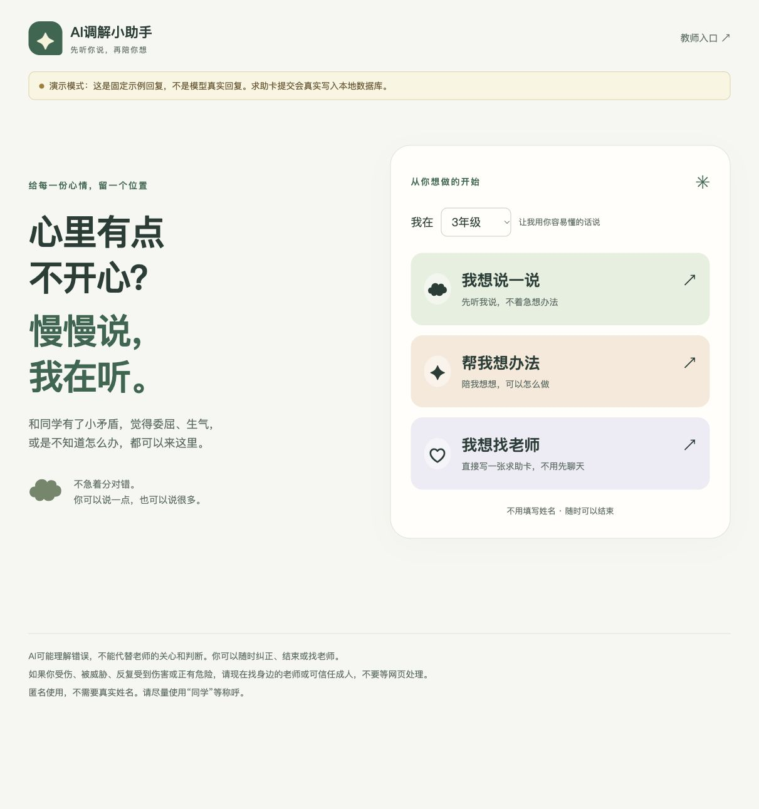

# AI调解小助手

## 直接发布网页：GitHub Pages 展示版

本仓库新增纯前端展示版，代码在 `static/`，与原 Next.js 后端版独立。Pages 不需要启动 Node 服务或配置数据库；原服务端代码保留，供以后使用。

1. 将本次修改提交并推送到 GitHub 的 `main` 分支。
2. 在仓库打开 **Settings → Pages → Build and deployment → Source**，选择 **GitHub Actions**。
3. 打开 **Actions → Deploy browser demo to GitHub Pages**。如首次运行失败或没有自动运行，点击 **Run workflow**，选择 `main`。
4. 等待部署成功，到 **Settings → Pages** 查看实际网址。对于 `ZaVz/ai-mediator`，通常为 `https://zavz.github.io/ai-mediator/`。
5. 内置模型：仓库 **Settings → Secrets and variables → Actions → New repository secret**，新增名称 `AI_API_KEY`，值填演示用密钥。`Variables` 中可设置 `AI_BASE_URL` 和 `AI_MODEL`，不设置时默认 DeepSeek 地址与 `deepseek-flash`。然后重新运行 Pages 工作流。页面打开即可聊天，无需访客填写。

本地 `npm run build:pages` 会自动读取 `.env.local` 的模型配置；GitHub 不会读取电脑上的文件，自动部署使用上述仓库 Secrets/Variables。工作流缺少密钥时会失败，避免误把演示回复当成真实模型。仓库中不保存密钥，但构建产物 `dist/config.js` **会公开包含密钥**，访问者可提取；GitHub Secrets 仅保护构建输入，不会使发布后的密钥保密。展示结束后应在模型平台撤销临时密钥，并撤下或重新部署网页。

内置密钥时隐藏模型设置入口并优先使用构建配置，不受旧浏览器配置影响。手动本地构建没有密钥时，仍可进入明确标注的固定回复模式，设置页也可临时填写配置。

模型供应商必须支持来自浏览器的跨域请求（CORS）；网络或跨域限制失败会明确提示，不能保证所有供应商均可用。

**展示范围：** 每位访问者使用自己的配置和本地记录。学生和教师需使用同一浏览器配置、同一网站地址，在两个普通标签页里演示；不同设备、不同浏览器或隐私窗口不会共享。教师页实时读取本地存储变化，不发送邮件或远程通知。教师展示入口没有真实登录保护，不能用作真实学生数据管理系统。清理浏览器数据会丢失记录。

学生安全关注消息只写入本浏览器的收件箱，页面明确说明没有跨设备通知。AI/规则可能误报漏报，有危险必须寻找身边成人。原求助卡内容仍由孩子编辑确认后提交。

本地预览纯前端版（需要先安装依赖；只用于构建和预览，部署后无需电脑运行）：

```bash
npm ci
npm run build:pages
python3 -m http.server 8080 --directory dist
```

打开 `http://localhost:8080`。`dist/` 为生成文件，不需要提交。下面保留的启动、数据库和后端接口说明只适用于原 Next.js 服务端版；Pages 不运行这些 `/api/*` 接口，也不读取 `.env.local`。

---

面向小学一至六年级的同伴纠纷倾诉与求助网页。先倾听孩子的感受，再按孩子的意愿继续倾诉、想办法或找老师。

- 三个入口：我想说一说、帮我想办法、我想找老师。
- 匿名文字对话，可随时纠正AI、切换模式、结束或找老师。
- 求助卡可编辑，孩子确认后才会提交；教师登录后查看和标记处理状态。
- 教师另有收件箱：对话出现自伤、受到威胁、反复遭受伤害或伤害他人/报复社会信号时，自动记录“需人工核实”消息，无需学生再提交求助卡。学生首页和聊天页提前说明此机制。
- Next.js + TypeScript + Prisma + SQLite，模型供应商通过服务端环境变量配置。

项目支持本地开发和单机 Node.js 服务器部署。当前产品验证场景是本地或课堂展示；可将源码放到 GitHub 维护，运行环境和密钥独立配置。



## 第一次打开项目

先安装 **Node.js 22 或24 LTS**（包含 npm）。下面的命令都在包含 `package.json` 的项目文件夹中执行。仓库以 `ai-mediator/` 内的内容为根目录；不要把它再嵌套一层上传。

```bash
npm ci
cp .env.example .env.local
```

已有 `.env.local` 时不要再次复制覆盖。`.env.example` 是可以提交到 GitHub 的空白模板；`.env.local` 是你自己的实际配置，已被 Git 忽略。Windows 可直接复制文件并重命名。

打开 `.env.local`：

- `DATABASE_URL` 保持 `file:./dev.db` 即可体验。
- `TEACHER_PASSWORD` 填自己的教师密码，至少12个字符；留空时教师入口不能登录。
- 接真实模型时填写 `AI_BASE_URL`、`AI_API_KEY`、`AI_MODEL`；密钥不要发到聊天或提交到 GitHub。
- 暂时不填密钥也能使用明确标注的演示模式，求助卡仍会真实保存到数据库。

然后执行：

```bash
npm run setup
npm run dev
```

看到终端显示 `Local` 地址后，用浏览器打开它，通常是 <http://127.0.0.1:3000>。教师入口在页面右上角。网页运行期间保持终端开启，结束时按 Ctrl+C。修改模型配置后，需要停止并重新启动服务。

## 以后再次打开

数据库初始化后无需每次重新安装或初始化：

```bash
npm run dev
```

拉取他人的依赖或数据库结构更新后，再运行 `npm ci` 和 `npm run setup`。`setup` 使用已提交的迁移初始化/升级数据库，不会执行重置命令。

## 放到 GitHub

应提交源码、`package.json`、`package-lock.json`、`.env.example`、数据库结构和迁移文件，以及文档与自动检查配置。

不要提交实际密钥、教师密码、`.env.local`、学生数据库、`node_modules/` 或 `.next/`；仓库的 `.gitignore` 已包含对应规则。忽略规则不会清除已经提交过的密钥或历史记录，若曾上传真实密钥，应更换密钥。

使用 npm 统一管理依赖。`npm ci` 严格按照锁文件安装；添加/升级依赖时用 `npm install`，一起提交生成的 `package-lock.json`。

GitHub Actions 已配置为在 Node.js 22、24 的 Linux 环境检查安装、数据库迁移、类型、构建和接口测试。只有推送到 GitHub 后才会真正运行远程检查，不把本机通过当作远程通过。

**上传 GitHub 不等于网页已经上线。** GitHub Pages 是静态网页托管，本项目有后端、教师登录和数据库，需要部署到支持 Node.js 服务的环境。详见 [服务器部署说明](docs/DEPLOYMENT.md)。

## 环境变量

| 变量 | 配置方式 |
|---|---|
| `AI_BASE_URL` | 模型基础地址；代码会追加 `/chat/completions`。公开服务要求HTTPS，运行在同机的模型允许本机HTTP。 |
| `AI_API_KEY` | 服务端密钥，只在 `src/lib/ai.ts` 读取。禁止使用 `NEXT_PUBLIC_`。 |
| `AI_MODEL` | 供应商支持的模型标识。 |
| `DATABASE_URL` | SQLite路径。本地默认相对于 `prisma/schema.prisma`；服务器建议绝对路径和持久化目录。 |
| `TEACHER_PASSWORD` | 至少12字符；无默认密码。 |
| `DEMO_MODE` | `true` 强制演示；`false` 且有密钥时调用模型。无密钥时始终明确显示演示模式。 |
| `PORT` | 可选的运行端口，由 Next.js 启动命令读取，例如3000。 |

未配置密钥时回复明确标注“演示模式：这是固定示例回复，不是模型真实回复”。配置了密钥但模型不可用时会报错并保留输入，不会把模拟回复显示成模型结果。

DeepSeek官方接口已适配JSON输出和当前Flash/V4模型的非思考模式。多轮历史保留原始回复格式；空回复或格式错误最多自动恢复一次，最终失败仍保留孩子原话和重试入口。具体错误码与恢复方式见接口文档。

教师登录后，进入“收件箱”查看未读/已读/已跟进消息；打开页面时约每10秒检查新消息。消息包含年级、匿名会话编号、触发原话和时间，不开放完整聊天。明确措辞先由本地规则记录，不依赖模型在线；模型额外结合上下文提示。普通负面情绪、否认和引用不应仅因关键词被上报，但仍可能误报、漏报，需要老师核实，不是心理诊断。消息保存不代表老师已看到或已提供帮助。

## 常用命令

| 命令 | 用途 |
|---|---|
| `npm run setup` | 生成数据库客户端，并应用已提交的数据库迁移。 |
| `npm run dev` | 本机开发，默认监听127.0.0.1。 |
| `npm run build` | 生产构建。 |
| `npm start` | 运行构建后的服务，支持服务器访问和平台注入的PORT。 |
| `npm run typecheck` | TypeScript检查。 |
| `npm run test:api` | 在临时数据库和临时端口测试接口；需要先构建，不调用真实模型。 |
| `npm run prisma:migrate -- --name 描述` | 开发中修改数据库结构后创建迁移。 |

Prisma命令通过 `scripts/prisma.mjs` 加载环境配置，因此能读取 `.env.local`。直接使用原生 `npx prisma` 不会自动读取该文件。正式部署时使用平台/进程环境变量，无需提交 `.env.local`。

## 进一步阅读

- [接口请求、响应与错误说明](docs/API.md)
- [服务器部署与数据持久化](docs/DEPLOYMENT.md)
- [页面功能、鉴权、数据管理和实现边界](docs/DESIGN.md)
- [已实际执行的验证与未验证事项](VERIFICATION.md)

AI可能理解错误，不能代替老师的关心和判断。第一版不收集姓名、班级或联系方式，教师无法仅凭匿名编号确定孩子身份，需通过课堂/学校跟进流程核实。删除聊天不会撤回已保存到教师端的求助卡或安全关注消息。
